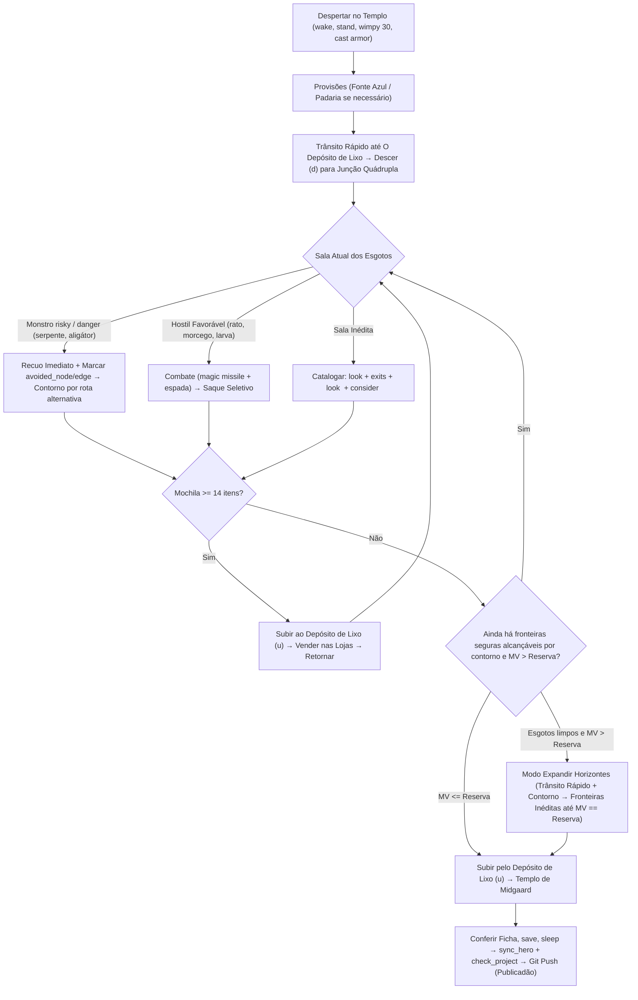

# Flow Modular de Expedição: Limpeza dos Esgotos + Expandir Horizontes (Dia 95+)

## Visão Geral da Arquitetura
Este fluxo aplica o motor modular V2 (`scripts/expedition/`) aos **Esgotos de Midgaard** para o **Dia 95+**, combinando:
1. **Mapeamento + Limpeza Seletiva com Contorno (`clear` + `avoided_nodes`):** Explora os túneis em BFS/DFS dinâmico a partir do alçapão reversível de *O Depósito de Lixo* (`d` para entrar, `u` para sair), abatendo todos os monstros avaliados como `favorable` (`rato`, `morcego`, `larva`, etc.). Ao encontrar um bicho `risky` ou `danger` (`serpente`, `aligátor`, etc.), **a expedição nunca para**: marca o nó/aresta em `avoided_nodes` / `avoided_edges`, recua imediatamente para a sala segura anterior e calcula um **contorno (`graph.path()`)** por túneis alternativos para continuar limpando e mapeando o restante do mapa sem trombar com ele.
2. **Modo Expandir Horizontes Otimizado (`HorizonExpander`):**
   - **Trânsito Rápido em Salas Conhecidas:** Caminha sem pausas de catalogação repetida (`exits`, `look <detalhe>`, `consider`) pelas salas já conhecidas no grafo, drenando MV mais rápido que o tick de regeneração do servidor.
   - **Catalogação Profunda em Salas Inéditas + Contorno:** Executa `look`, `exits`, `look <detalhe>` e `look`/`consider <npc>` em salas novas; se encontrar monstro `risky`/`danger`, contorna pela malha conhecida e segue abrindo outras fronteiras até que o MV caia até a **reserva dinâmica de retorno** (`dynamic_mv_reserve()`).
3. **Definition of Done (Fechamento + Publicação):** Todo dia termina obrigatoriamente com `save` + `sleep` no santuário, atualização documental (`sync_hero.py` e `check_project.py` com 0 erros) e publicação (`git commit` + `git push`).

## Regras Críticas para os Esgotos (Zone 70)
- **Entrada/Saída Exclusiva pelo Depósito de Lixo:** Nunca descer pelo buraco do *Laboratório dos Magos* sem pergaminho de retorno, pois a queda lá é de mão única. Pela *Junção Quádrupla Abaixo do Depósito de Lixo*, a saída `up` (`u`) leva de volta à superfície.
- **Contorno sem Parar a Expedição (`avoided_nodes` / `avoided_edges`):** Ao avistar uma *serpente dos esgotos*, *aligátor* ou qualquer criatura cujo `consider` retorne `risky` ou `danger`, o executor **não interrompe a expedição**: recua no 1º turno (`OPPOSITE[came_from]`), registra a sala/aresta como evitada no `WorldGraph` e usa o BFS (`graph.path()`) para contornar o predador por galerias paralelas e limpar o resto dos esgotos.
- **Abate de Morcegos e Ratos (Rumo ao Nível 12):** Morcegos nos esgotos concedem alto XP (~6.000–8.600 EXP); como Grebolius está com `195.202 / 200.000 EXP` (faltam apenas `4.798 EXP`), 1 ou 2 abates nos esgotos já garantirão a ascensão ao **Nível 12** logo no início do Dia 95.

